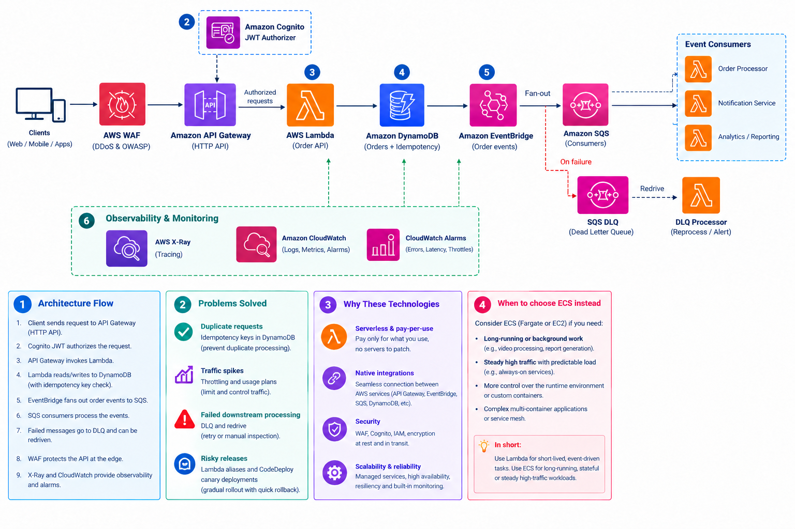

# Event-Driven Serverless Order API

An AWS order-processing application built with Terraform and Python. It accepts authenticated orders through a REST API, stores them in DynamoDB, and distributes order-created events to independent processing, notification and analytics consumers.

The project demonstrates idempotent API requests, transactional outbox publishing, asynchronous processing, failure recovery, observability and GitHub Actions deployment using OIDC.

> **Project scope:** this is a development/reference implementation. Order processing currently advances an order to `PROCESSING`; payment, inventory reservation, shipping and completion workflows are future work. Checkov security scanning is planned and is excluded from the current CI checks. Linting and automated tests remain part of the development workflow.

## Architecture




Each consumer has a separate queue and processing DLQ. EventBridge targets also have delivery DLQs. Failed outbox stream batches are stored in S3. CloudWatch provides logs, metrics, dashboards and alarms; SNS routes configured alerts to confirmed email subscribers.

### Request and event flow

1. A client obtains a Cognito access token and calls `POST /orders` with JSON and an `Idempotency-Key` header.
2. API Gateway applies the method's authorization requirements and invokes the Order API Lambda.
3. The handler derives the customer ID from the authenticated user's Cognito `sub`, validates the request and checks idempotency.
4. One DynamoDB transaction writes the order, idempotency record and outbox event.
5. The API returns the new order ID with status `CREATED`.
6. A DynamoDB stream event invokes the publisher, which sends the stored event to EventBridge.
7. Matching rules deliver the event to each consumer's queue. Consumers process independently and use the stable event ID to recognize duplicates.

The API response confirms acceptance and persistence; it does not wait for downstream processing to finish.

## Technology

| Area               | Implementation                                               |
| ------------------ | ------------------------------------------------------------ |
| Infrastructure     | Terraform with AWS provider                                  |
| API                | API Gateway REST API and Lambda proxy integration            |
| Authentication     | Cognito user pool and OAuth scopes                           |
| Request filtering  | AWS WAF                                                      |
| Application code   | Python 3.12 on AWS Lambda                                    |
| Storage            | DynamoDB orders, idempotency, outbox and consumer records    |
| Event distribution | DynamoDB Streams, EventBridge and SQS                        |
| Optional email     | EventBridge Scheduler, Lambda and SES                        |
| Operations         | CloudWatch, SNS and sampled X-Ray tracing where configured   |
| CI/CD              | GitHub Actions with AWS OIDC                                 |
| Code quality       | Terraform formatting/validation, TFLint, Ruff and unit tests |

## Repository structure

```text
.github/
  workflows/
    checks.yml
    deploy-dev.yml
bootstrap/
  ...                         # Terraform state backend bootstrap
  github-oidc/                # GitHub identity and deployment role
environments/dev/             # Application root module
modules/
  api/
  auth/
  database/
  lambda/
  waf/
  event_bus/
  outbox_publisher/
  order_consumer/
  event_consumer/
  email_sender/
  alerting/
  observability/
services/
  order_api/src/
  outbox_publisher/src/
  order_processor/src/
  event_consumer/src/
  email_sender/src/
scripts/
  ci_checks.sh
  replay_outbox.py
  audit_orders.py
  test_handlers.py
  test_order_processor.py
  test_consumers.py
  test_audit.py
.tflint.hcl
ruff.toml
```

The dev root connects child modules by passing outputs such as table ARNs, queue URLs and bus names into module inputs. Notification and analytics are separate instances of the reusable `event_consumer` module. Provider configuration and backends belong to root modules; child modules declare their provider requirements and inherit provider configuration.

## Prerequisites

- An AWS account and an authenticated AWS CLI profile with deployment permissions.
- Terraform 1.10 or newer, compatible with the repository's version constraints. Use the same tested CLI version locally and in CI.
- Python 3.12 and virtual-environment support.
- Git, GitHub and GitHub CLI for OIDC setup.
- TFLint and the configured AWS ruleset for Terraform linting.
- A verified SES identity if enabling email delivery.

Commit `.terraform.lock.hcl` for each root module. It locks provider selections; it does not lock the Terraform CLI version. Keep AWS credentials, tokens, state files, saved plans and sensitive variable files out of Git.

## Local setup and deployment

### 1. Configure AWS credentials

```bash
export AWS_PROFILE=YOUR_AWS_PROFILE
export AWS_DEFAULT_REGION=us-east-1
aws sts get-caller-identity
```

Use the region configured for your project. Root provider and backend configurations should use the AWS credential chain rather than hardcoded credentials or a profile that only exists on one computer.

### 2. Prepare Terraform state

For an existing deployment, reuse the existing state bucket and dev state key. For a new installation, create the state backend using the original bootstrap first.

The application and GitHub OIDC bootstrap use different state keys. Do not point a new root at another root's state object.

### 3. Configure dev inputs

Populate `environments/dev/terraform.tfvars` with values required by that root's variable declarations. These include project/environment settings, Cognito configuration and any optional email or alert settings.

Important settings:

- Keep `enable_email_delivery = false` until SES and recipient prerequisites are ready.
- Configure `alert_emails` and confirm the SNS subscription emails.
- Set `manage_apigateway_logging_account = true` only when this root owns the regional API Gateway logging-role setting.
- Preserve existing values when moving deployment from local Terraform to GitHub Actions.

### 4. Plan and apply

```bash
terraform -chdir=environments/dev init
terraform -chdir=environments/dev validate
terraform -chdir=environments/dev plan -out=dev.tfplan
terraform -chdir=environments/dev apply dev.tfplan
terraform -chdir=environments/dev output
```

Review the plan before applying. If Terraform proposes creating an already deployed stack, check the AWS account, region and backend state key first.

## API usage

| Method | Path           | Purpose                                     | OAuth scope    |
| ------ | -------------- | ------------------------------------------- | -------------- |
| `POST` | `/orders`      | Create an order                             | `orders/write` |
| `GET`  | `/orders/{id}` | Retrieve the authenticated customer's order | `orders/read`  |

Use a Cognito access token with the appropriate scopes. A public OAuth client uses authorization code flow with PKCE. The callback URL configured in the client must match the one used by your API testing tool.

Set `API_BASE_URL` to the deployed stage URL, including `/dev` when applicable. Set `ACCESS_TOKEN` locally to a valid access token; do not commit it.

```bash
export API_BASE_URL='https://YOUR_API_ID.execute-api.us-east-1.amazonaws.com/dev'

curl --request POST "$API_BASE_URL/orders" \
  --header "Authorization: Bearer $ACCESS_TOKEN" \
  --header 'Content-Type: application/json' \
  --header 'Idempotency-Key: example-order-001' \
  --data '{"items":[{"product_id":"product-001","quantity":2}]}'
```

Example response:

```json
{
  "order_id": "example-order-id",
  "status": "CREATED",
  "created_at": "2026-10-19T09:00:00+00:00"
}
```

Retrieve the returned order:

```bash
curl "$API_BASE_URL/orders/ORDER_ID" \
  --header "Authorization: Bearer $ACCESS_TOKEN"
```

An order can become `PROCESSING` after the order consumer runs. Requests for another customer's order are not exposed by the handler.

### Idempotency

Within the configured idempotency window (24 hours in the starter handler):

- The same customer, key and normalized request return the original creation response.
- Reusing the key with a different request returns a conflict.
- Using a new key permits a new order, including an order for the same product.

Idempotency prevents duplicate creation during retries. It does not prohibit customers from ordering the same product again.

### Event contract

Order-created events use:

```text
source:       com.example.orders
detail-type:  OrderCreated
detail:       schema_version, event_id, order_id, customer_id,
              created_at, items and order status
```

Consumers deduplicate using `detail.event_id`. Delivery can repeat, so the architecture does not claim end-to-end exactly-once execution.

## Linting and tests

Linting remains enabled. Checkov is excluded from the current pipeline and tracked in the security roadmap below.

Install Ruff in a local virtual environment using the repository's pinned tooling requirements if available:

```bash
python3 -m venv .venv
source .venv/bin/activate
python -m pip install ruff
```

Keep the selected tooling versions pinned for reproducible CI runs. TFLint is installed separately through its official release/setup tooling.

Run from the repository root:

```bash
terraform fmt -check -recursive environments modules bootstrap
terraform -chdir=environments/dev init -backend=false -lockfile=readonly
terraform -chdir=environments/dev validate

tflint --init
for directory in environments modules bootstrap; do
  tflint --chdir="$directory" --recursive --config="$PWD/.tflint.hcl"
done

ruff check services scripts
ruff format --check services scripts

python scripts/test_handlers.py
python scripts/test_order_processor.py
python scripts/test_consumers.py
python scripts/test_audit.py
```

The test suites run separately because they mock AWS SDK modules independently. They verify application behavior without contacting AWS. They do not substitute for authenticated API and event-delivery integration tests.

If the repository uses `scripts/ci_checks.sh`, it runs the existing formatting, compilation, validation and test checks; Ruff and TFLint may be separate workflow steps. Ensure any shared script invoked by CI no longer calls Checkov while it is excluded. Removing Checkov should not remove lint or test steps.

## GitHub Actions deployment

Pull requests run checks. Dev deployment is manually triggered on `main` and authenticates through GitHub OIDC, avoiding stored AWS access keys.

1. Bootstrap the GitHub OIDC provider/deployment role locally using `bootstrap/github-oidc`.
2. Match the AWS trust policy to the actual GitHub OIDC subject, including immutable owner/repository IDs when enabled.
3. Create a GitHub environment named `dev` and restrict deployment branches to `main`.
4. Set repository variable `TERRAFORM_VERSION` to the CLI version tested with this project.
5. Configure the dev environment values below.

| Setting               | Type                 | Purpose                                                  |
| --------------------- | -------------------- | -------------------------------------------------------- |
| `AWS_REGION`          | Environment variable | AWS deployment region                                    |
| `AWS_ACCOUNT_ID`      | Environment variable | Expected AWS account                                     |
| `AWS_DEPLOY_ROLE_ARN` | Environment variable | OIDC deployment role                                     |
| `TF_STATE_BUCKET`     | Environment variable | Existing state bucket                                    |
| `TF_STATE_KEY`        | Environment variable | Existing dev state key                                   |
| `DEV_TFVARS_JSON`     | Environment secret   | JSON object containing the complete dev Terraform inputs |

Run **Deploy dev** with `apply` unchecked to inspect a plan. Run with `apply` checked to create a fresh plan and apply that saved plan in the same job. The earlier preview is not the plan applied by the later run.

The pipeline serializes dev deployment runs and Terraform locks state. It does not deploy the separate bootstrap roots. Require the checks job in main's branch rules. Environment reviewer approval, if configured, occurs before the deployment job; this starter does not pause between its plan and apply steps.

## Observability and recovery

- Inspect API access/execution logs for request IDs, authorization failures and integration errors.
- Inspect Lambda logs for the order ID and stable event ID.
- Use CloudWatch dashboards and alarms for failures, queue age, DLQ depth and publisher stream lag.
- Confirm SNS subscriptions before relying on alert email delivery.
- X-Ray tracing is sampled and does not provide a complete cross-service business-event history by itself.

### Failure destinations

| Destination                 | Meaning                                                     |
| --------------------------- | ----------------------------------------------------------- |
| EventBridge delivery DLQ    | EventBridge could not deliver to the target queue           |
| Consumer processing DLQ     | Repeated processing attempts failed after delivery to SQS   |
| Publisher failure S3 bucket | Stream processing exhausted its configured retry/age policy |

Investigate the cause before redriving. `scripts/replay_outbox.py` can republish a retained outbox event with its original event ID. Use `--help` for arguments. An outbox row's presence does not mean publication is still pending.

`scripts/audit_orders.py` performs a bounded, read-only comparison of outbox events, orders and consumer records. It reports inconsistencies without automatically replaying events or resending email. Use `--help` for configuration and scan limits.

Optional email delivery records `PENDING`, `SENDING`, `SENT`, `FAILED` or `REVIEW`. `SENT` means SES accepted the request, not that it reached the inbox. Investigate uncertain delivery before retrying to avoid duplicate messages.

## Security status and roadmap

### Controls implemented in the project

- Cognito authorization and customer ownership checks in the order handler.
- IAM execution roles for individual functions and resource-scoped runtime permissions where supported.
- WAF association and managed request-filtering rules.
- Input validation and customer-scoped idempotency.
- Private S3 failure storage, public-access blocking and HTTPS enforcement.
- Encryption at rest through the configured AWS service defaults/settings; customer-managed KMS keys are not configured everywhere.
- GitHub OIDC with repository/environment trust restrictions.
- Logs, alarms and failure destinations to support investigation and recovery.

The dev deployment role has broad infrastructure-management permissions. It is intended for a dedicated development account and requires further restriction for production.

### Planned security improvements

- [ ] Reintroduce Checkov into CI after reviewing the initial findings and recording justified resource-level exceptions.
- [ ] Refine deployment IAM permissions and review policy changes using IAM Access Analyzer validation.
- [ ] Add customer-managed KMS keys where required, including SNS publisher permissions, and verify alert delivery after encryption changes.
- [ ] Add full WAF request logging with suitable redaction and retention.
- [ ] Review API Gateway request validators/models alongside existing handler validation.
- [ ] Define retention/lifecycle policies for failed batches and logs.
- [ ] Add dependency vulnerability and secret scanning.
- [ ] Pin third-party GitHub Actions to reviewed commit SHAs.
- [ ] Add a signed Lambda artifact workflow and code-signing validation.
- [ ] Audit the deployed AWS configuration using a separate audit role.

Checkov has been evaluated locally but is **not an enforced CI security gate**. A passing lint/test pipeline does not establish security compliance. Findings involving VPC placement, caching, replication or customer-managed keys require architecture and environment decisions rather than blanket enablement.

## Other future work

- Inventory, payment and fulfillment workflows beyond `PROCESSING`.
- Authenticated integration and load testing with reproducible results.
- Lambda versions/aliases and CodeDeploy canary releases with rollback alarms.
- Separate production configuration, tighter permissions and recovery objectives.
- Email delivery/bounce handling and additional notification channels.

## Cleanup

Destroying the application deletes its data, including DynamoDB records and Cognito users. Export anything you need first and ensure no deployment workflow is running.

```bash
terraform -chdir=environments/dev init
terraform -chdir=environments/dev plan -destroy -out=destroy.tfplan
terraform -chdir=environments/dev apply destroy.tfplan
```

Destroy the separate GitHub identity root only when it is no longer needed, and inspect whether its OIDC provider is shared. Keep the state backend until all dependent roots have been cleaned up. Versioned S3 objects, deletion protection or `prevent_destroy` may require deliberate cleanup before destruction succeeds.

WAF, logs, dashboards, storage and other configured services can incur charges without active order traffic. Inspect retained resources and billing after cleanup. No benchmark throughput or cost estimate is claimed by this README.